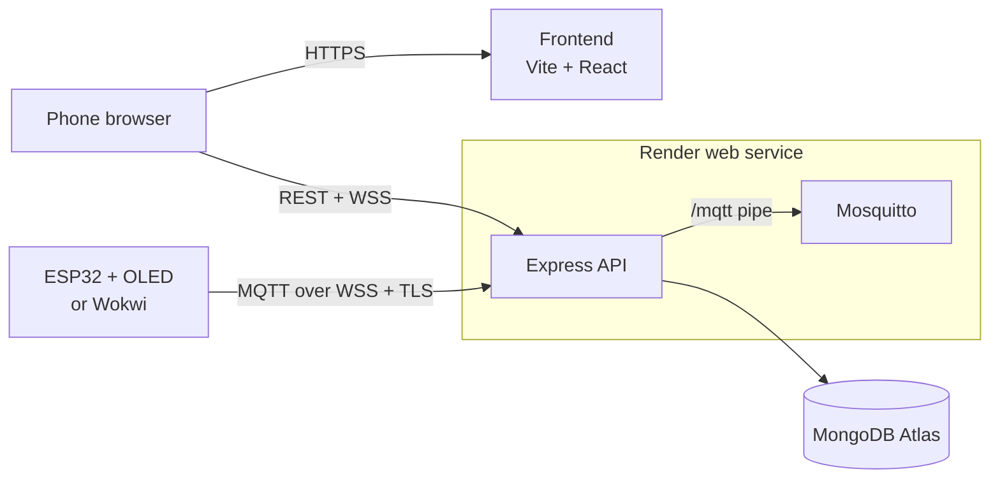

<div align="center">

# esp32-oled

An ESP32 with a 1.3" OLED that you control from your phone: robot eyes that follow its tilt, and song lyrics shown in sync with the music.

[](https://github.com/sonal-monis-10/embedded--learning/stargazers)

</div>

## What is this?

Three parts that work together: **firmware** for an ESP32 with an SH1106 OLED (or a Wokwi simulation), a **backend** on Render that registers devices and hosts the MQTT broker, and a **frontend** where a phone pairs with a device by scanning a QR code. The OLED shows its own pairing QR; there are no accounts: you type a name when you pair, one person plays at a time, and all people data is wiped every night at 00:00 IST.

**Status:** phase 1 of 4 ([plan](docs/plan/README.md)). Done so far: the OLED demo firmware, the backend API (sessions, pairing codes, nightly cleanup) and a first pass of the phone app. In progress: devices that register themselves and show their pairing QR on the OLED, one phone per device, and robot eyes driven by the phone's tilt; then the Mosquitto broker, the firmware's network code and the Render deploy.



Full diagram: [docs/architecture.html](docs/architecture.html). Open it in a browser.

## Quick Start

You need [nvm](https://github.com/nvm-sh/nvm) with Node 24, [PlatformIO](https://platformio.org/) for the firmware, and a MongoDB connection string (the Atlas free tier works).

```bash
nvm use          # Node 24, from .nvmrc
make install     # npm ci in backend/ and frontend/
```

Create `backend/.env`. It is git-ignored, and every variable is checked at startup:

```env
MONGODB_URI=mongodb+srv://<user>:<password>@<cluster>.mongodb.net/
PROVISION_KEY=<at least 24 random characters>   # also goes into firmware.env
ADMIN_KEY=<at least 24 random characters>
SECRETS_KEY=<32 random bytes, base64>   # node -e "console.log(require('crypto').randomBytes(32).toString('base64'))"
```

Without Mosquitto on your laptop, add `MQTT_ENABLED=false` to run the API alone; the Docker image (`backend/Dockerfile`) runs the broker. With it enabled, also set `MQTT_ADMIN_PASSWORD` and `MQTT_BACKEND_PASSWORD` (16+ characters).

Back up `SECRETS_KEY`: it encrypts the device secrets, and losing it means re-registering every device.

Run the backend and frontend in two terminals:

```bash
make dev-backend    # http://localhost:8080/healthz
make dev-frontend   # http://localhost:5173
```

Devices register themselves on first boot with the `PROVISION_KEY` built
into their firmware (being built now, see the [phase 1 plan](docs/plan/phase-1-foundation.md)).

Flash the current OLED demo to a board on USB:

```bash
make oled        # SH1106 build, flash, open the serial monitor
make scanner     # I2C scanner, if the screen stays blank
```

Before committing, run the checks:

```bash
make test        # backend tests (in-memory MongoDB) + frontend build; broker tests skip without Mosquitto
make test-docker # the same inside the backend image, broker tests included (needs Docker)
make lint        # ESLint + Prettier for both
make check       # compile every firmware environment
```

## Project Structure

```
esp32-oled/
├── backend/          Express 5 API, run as `node server.js`
│   ├── entity/       Mongoose schemas: device, user, session, pairingCode, deviceEvent, meta
│   ├── live/         /api/live WebSocket: tilt in, status and "turn ended" out
│   ├── middleware/   auth (provision/admin keys, sessions, controller), errors, rate limits, validation
│   ├── mqtt/         Mosquitto: supervisor, logins (Dynamic Security), presence, /mqtt pipe
│   ├── routes/       admin (provisioning, maintenance), pairing, devices, health
│   ├── test/         node:test suites, shared in-memory MongoDB
│   ├── utils/        config, secrets (AES-GCM), turns (release, idle), pairing issuer, cleanup
│   ├── app.js        MongoDB connection, middleware, route mounting
│   └── server.js     entry point, graceful shutdown, cleanup schedule
├── docs/             guides, architecture diagram, project plan
├── firmware/         PlatformIO project for the ESP32
│   ├── src/          main.cpp: OLED demo (SH1106 / SSD1306)
│   ├── tools/        I2C bus scanner
│   └── platformio.ini
├── frontend/         Vite + React app
│   ├── src/          App.jsx, services/ (API client)
│   └── vite.config.js
└── Makefile          shortcuts: install, dev-*, test, lint, oled, check, …
```

## Documentation

| Resource | Description |
|----------|-------------|
| [docs/plan/README.md](docs/plan/README.md) | Architecture decisions, security model, data model, MQTT topics, full API list |
| [docs/plan/phase-1-foundation.md](docs/plan/phase-1-foundation.md) | Current phase: pairing, devices, broker, firmware build, deploy |
| [docs/architecture.html](docs/architecture.html) | Architecture diagram (open in a browser) |
| [docs/how-main-works.md](docs/how-main-works.md) | Walk-through of the OLED demo firmware |
| [docs/display-ram.md](docs/display-ram.md) | OLED memory layout, pixel formula, raw I2C commands |
| [docs/README.md](docs/README.md) | Reading list: datasheets, I2C, libraries |
